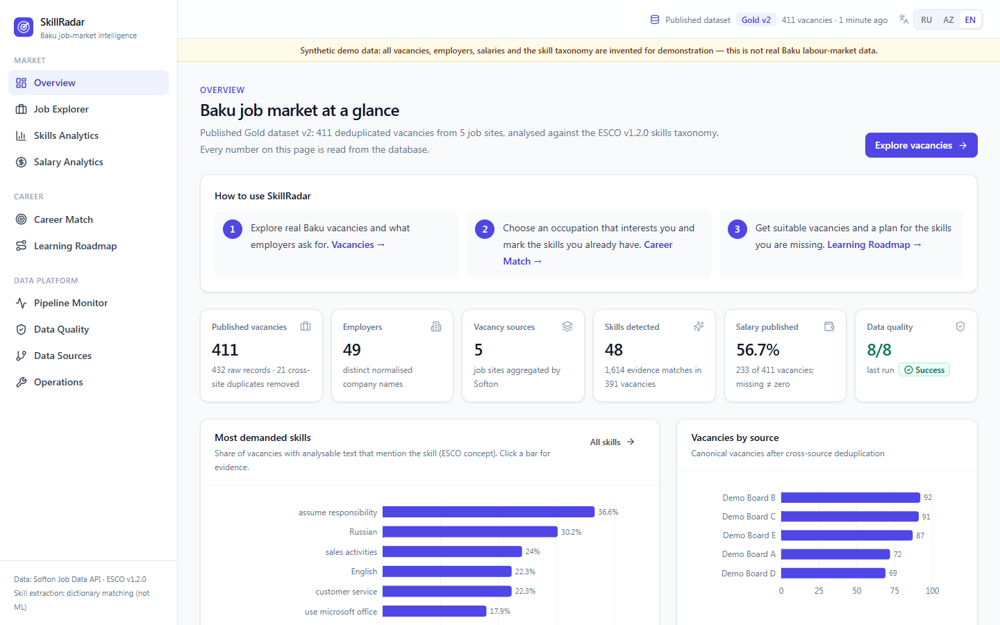
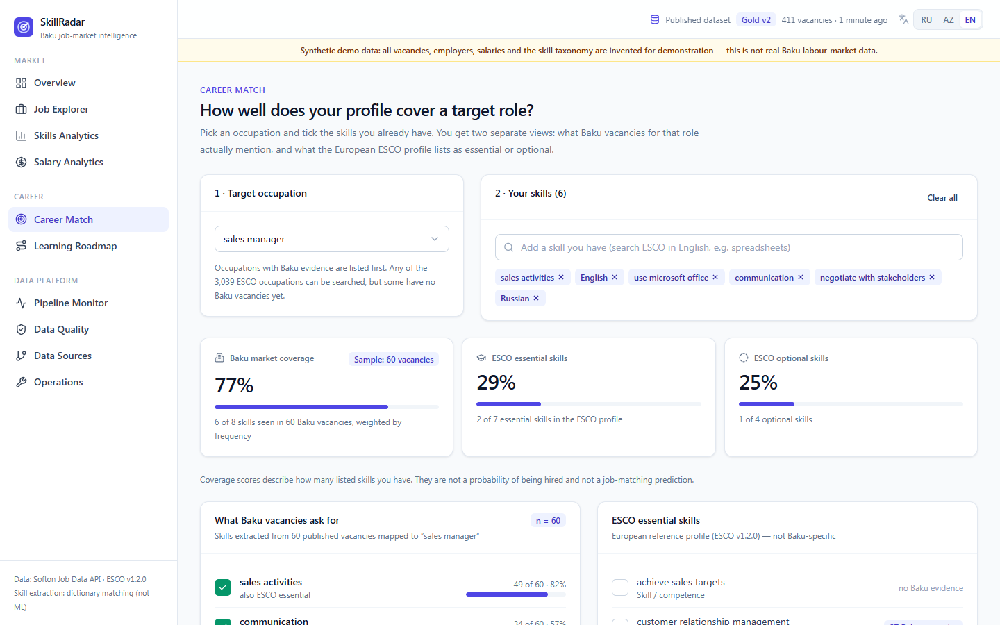
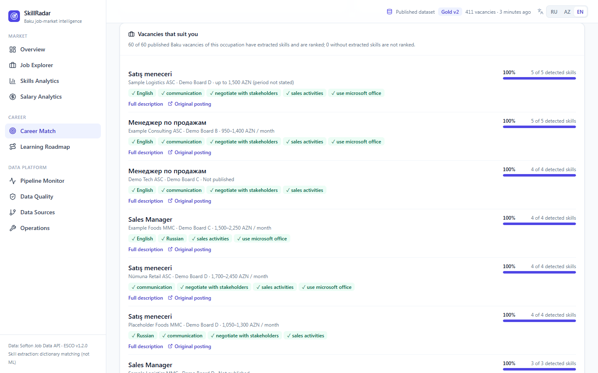
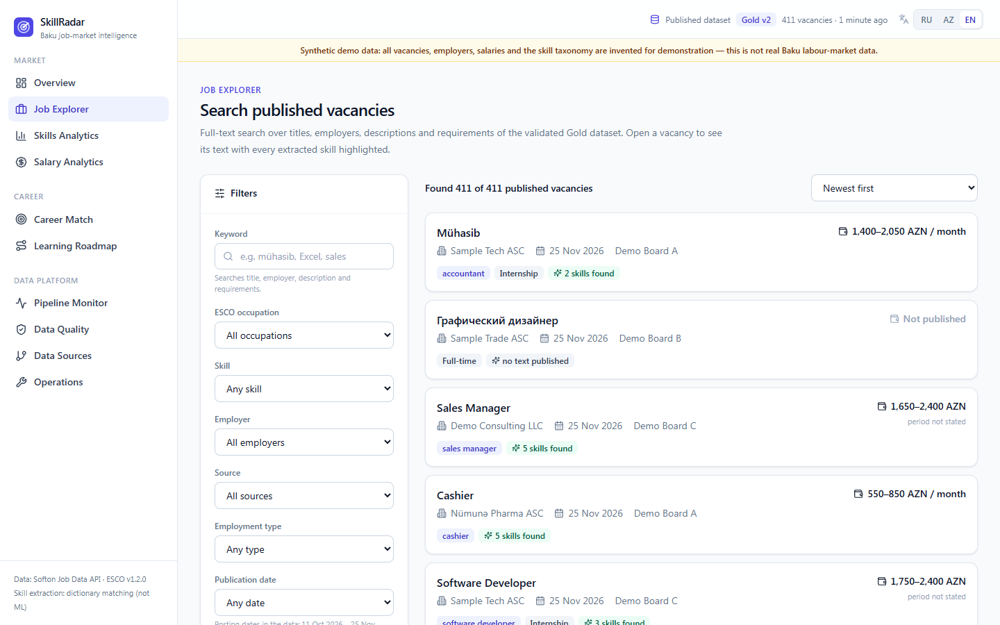
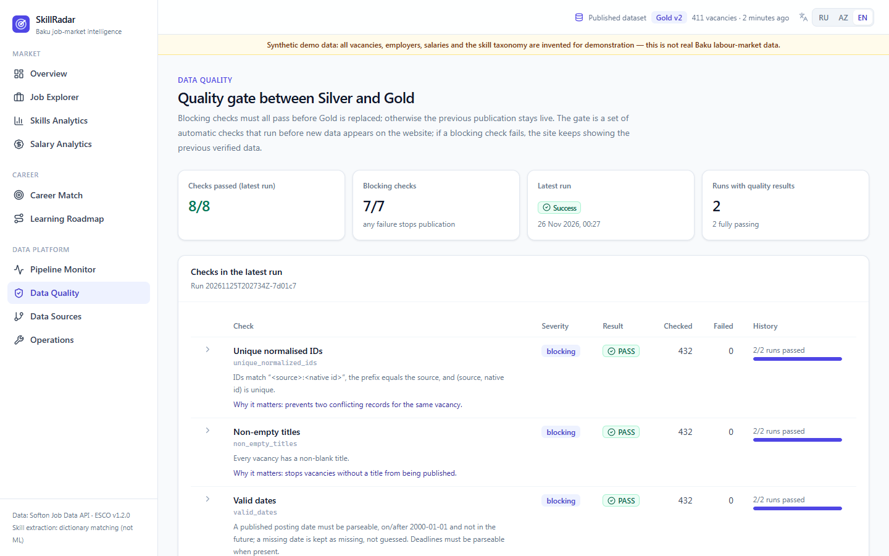
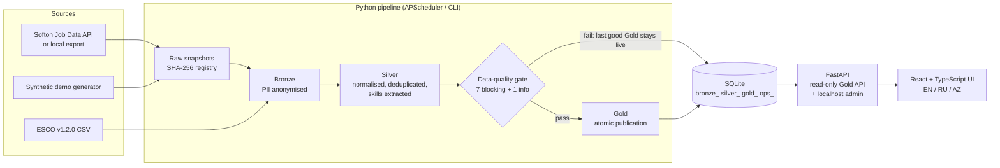

# SkillRadar — Job Market & Career Intelligence Platform

**AI-Assisted Academic Development Project** · Baku, Azerbaijan

SkillRadar collects job postings for Baku, cleans and validates them in a layered data pipeline, detects the skills
employers ask for (mapped to the European ESCO taxonomy), and turns the result into a web application that helps
graduates see what the market wants and what to learn next.



> All screenshots in this repository show the **synthetic demo dataset** (invented vacancies, employers and a small
> invented skill taxonomy) so that no third-party job data is redistributed. See [Data Sources](#data-sources).

---

## Project Overview

| | |
|---|---|
| **Type** | Academic project, developed with an AI coding assistant (see [AI-Assisted Development](#ai-assisted-development)) |
| **What it is** | An end-to-end data product: ingestion → Bronze/Silver/Gold warehouse → data-quality gate → skill extraction → REST API → web UI |
| **Runs on** | Windows 11, natively (Python + Node.js); no Docker or WSL required |
| **Languages of the UI** | English, Russian, Azerbaijani |

## Problem Statement

Graduates in Baku look for work across many job boards that publish postings in Azerbaijani, Russian and English,
with inconsistent formats, duplicated postings, missing salaries and free-text requirements. It is hard to answer simple
questions from this data: *Which skills are actually in demand? What does a given occupation require in Baku? Which of
my skills already match, and what should I learn next?*

SkillRadar answers these questions with traceable numbers: every published figure can be followed back to the raw
record and the exact text fragment that produced it.

## Target Audience

* University graduates and students choosing a career direction in Baku.
* Career advisers who need evidence about local skill demand.
* Reviewers of the project as an example of a reproducible, quality-gated data pipeline.

## Key Features

**Market analytics**
* **Overview** – published vacancies, employers, sources, detected skills, salary coverage and data-quality status.
* **Job Explorer** – full-text search with filters (occupation, skill, employer, source, employment type, posting date,
  salary range with overlap semantics) and a detail view that highlights every detected skill in the posting text.
* **Skills Analytics** – demand for each skill with the evidence snippets it was detected in.
* **Salary Analytics** – distributions and medians, always within one currency and pay-period group (never mixed).

**Career tools**
* **Career Match** – pick an occupation and your skills; see coverage of Baku market demand and of the ESCO profile as
  two separate measures, the vacancies that fit you best, and a side-by-side comparison with another occupation.
* **Learning Roadmap** – missing skills ranked by a transparent score, progress checklist, CSV export.

**Data platform**
* **Pipeline Monitor**, **Data Quality**, **Data Sources** – real run history, check results and source statistics.
* **Operations** (localhost only) – run the pipeline, backfill a date range, enable the scheduler, and run four
  reliability demonstrations in an isolated sandbox.

## Application Screenshots

| Career Match | Job recommendations |
|---|---|
|  |  |
| **Job Explorer** | **Data Quality** |
|  |  |

All 12 pages: [docs/screenshots](docs/screenshots/README.md).

## Data Sources

| Source | Used for | In this repository? |
|---|---|---|
| **Softon Job Data API** (aggregator of Baku job boards) | Real vacancies (`/v1/jobs`, cursor pagination, incremental loading, free plan of 100 requests/month) | **No.** Softon's acceptable-use page asks users not to republish the corpus in bulk, so raw postings, snapshots and the database with real vacancies stay private. |
| **ESCO v1.2.0** (European Commission) | Skill and occupation taxonomy (3,039 occupations, 13,939 skills, English CSV) | **No.** Download it free of charge from the [ESCO portal](https://esco.ec.europa.eu/en/use-esco/download). |
| **Curated alias lists** (`skillradar/skills/resources`) | Azerbaijani/Russian phrases mapped to ESCO labels; RU/AZ display labels | Yes. Written for this project; the RU/AZ labels are AI-assisted and **not official ESCO translations**. |
| **Synthetic demo dataset** (`skillradar/demo_data.py`) | Keyless demo and all screenshots | Generated locally; never mixed with real data. |

Details, licensing notes and the provenance chain: [docs/data_sources.md](docs/data_sources.md).

## System Architecture



More: [docs/architecture.md](docs/architecture.md) · [docs/database-schema.md](docs/database-schema.md)

## Data Engineering Pipeline

1. **Ingestion** – Softon API client with cursor pagination, a monthly request budget with reserve, retries with
   back-off (quota errors are not retried) and **no-skip incremental loading** (tie-safe watermark plus a stored resume
   cursor). Every response is saved as a write-once raw snapshot and registered by SHA-256, so re-runs are idempotent.
2. **Bronze** – raw records as received, with contact fields removed and e-mails/phone numbers redacted at ingestion.
3. **Silver** – normalised city, dates, salary, currency, employment type and employer; latest version per id;
   cross-source duplicates flagged (never deleted); skills and occupations detected with text evidence.
4. **Quality gate** – blocking checks decide whether the run may publish.
5. **Gold** – analytics tables published atomically in one transaction with a version number; the API reads Gold only.
6. **Operations** – run history, task retries, alerts, a run lock (one operation at a time), backfill by date range
   and a scheduler.

Skill detection is **dictionary-based, not machine learning**: an offset-preserving multilingual matcher over ESCO
labels and curated aliases ([docs/skill_extraction.md](docs/skill_extraction.md)).

## Data Quality and Reliability

| Check | Type |
|---|---|
| `unique_normalized_ids`, `non_empty_titles`, `valid_dates` (missing ≠ invalid), `valid_salary_ranges`, `normalized_baku_location`, `no_contact_pii_in_text`, `volume_not_collapsed` | blocking |
| `salary_coverage_info` | informational |

If any blocking check fails, publication is skipped and the previous Gold version stays live. Four sandbox
demonstrations prove this behaviour on demand: **idempotent rerun**, **failed validation and recovery**,
**date-range backfill**, **source failure and recovery**
([docs/reliability_demonstrations.md](docs/reliability_demonstrations.md), [docs/data_quality.md](docs/data_quality.md)).

## Technology Stack

| Layer | Technologies used in the project |
|---|---|
| Data & backend | Python 3.13, SQLite (WAL), FastAPI, Uvicorn, httpx, APScheduler, python-dotenv |
| Frontend | React 18, TypeScript, Vite, Tailwind CSS, Recharts, Lucide icons, react-i18next |
| Quality | pytest, TypeScript strict type check |
| Reference data | ESCO v1.2.0 |

This list describes the project, not the author's individual expertise (see [AI-Assisted Development](#ai-assisted-development)).

## Getting Started

Tested on **Windows 11** with **Python 3.13** and **Node.js 22**. Other platforms have not been tested.

### Option A — synthetic demo (no API key, no downloads)

```bat
git clone https://github.com/fobosrh-art/SkillRadar.git
cd SkillRadar
setup.cmd          :: creates .venv, installs Python and npm packages, builds the frontend, initialises the database
start-demo.cmd     :: generates the synthetic dataset in data-demo\, runs the pipeline, opens http://127.0.0.1:8000
```

The demo uses its own folder (`data-demo\`), shows a "Synthetic demo data" banner on every page, and never calls the
Softon API, even if a key is configured.

### Option B — real data

1. Download ESCO v1.2.0 (CSV, English) and copy `occupations_en.csv`, `skills_en.csv` and
   `occupationSkillRelations_en.csv` to `data\raw\esco\`.
2. Copy `.env.example` to `.env` and set `SOFTON_API_KEY` (or place a Softon JSON export in `data\raw\softon\`).
3. Run:

```bat
setup.cmd
.venv\Scripts\python -m skillradar fetch-live --max-pages 1   :: uses 1 request of the monthly budget
.venv\Scripts\python -m skillradar run
start.cmd                                                     :: http://127.0.0.1:8000
```

The server binds to `127.0.0.1` only. Other CLI commands: `python -m skillradar --help`.

## Testing

```bat
.venv\Scripts\python -m pytest        :: 66 tests, no network
cd frontend && npm run typecheck && npm run build
```

The tests cover normalisation, PII redaction, deduplication, the skill matcher, the full pipeline with invalid data,
incremental loading, the API, admin protection, the four demonstrations, the scheduler and the synthetic demo.
See [docs/testing.md](docs/testing.md).

## Project Results

**Real data** (private Softon data, measured on 2026-11-25; not included in this repository):

| Metric | Value |
|---|---|
| Raw vacancy records (Bronze) | 1,621 |
| Normalised records (Silver) | 1,515 |
| Published vacancies after cross-source deduplication (Gold) | 1,201 |
| Distinct employers / source job sites | 667 / 28 |
| Distinct ESCO skills detected / occupations detected | 340 / 80 |
| Skill evidence matches | 6,422 |
| Pipeline runs recorded | 23 (21 published, 2 blocked by the quality gate) |

**Engineering results** (reproducible from this repository): 66 automated tests passing, 8 data-quality checks,
4 reliability demonstrations passing, UI in 3 languages.

The synthetic demo produces different, invented numbers (about 410 vacancies); they say nothing about the Baku market.
Full measurements: [docs/final-results.md](docs/final-results.md).

## AI-Assisted Development

This is an **AI-assisted academic project**. The code, tests and most documentation were produced by an AI coding
assistant (Claude Code) working under the direction of the project author.

**The author's contribution:** defining the problem and the product; writing and refining the requirements for each
phase; directing the AI-assisted development; analysing the data and the results; functional testing of the
application; finding problems (for example a navigation bug, wrong counters, unclear career metrics, a salary record
that needed a reviewed exception) and verifying the fixes; deciding on data-usage and API-budget questions; delivering
a working product.

The author does not claim to have written the code by hand or to be an expert in every technology listed above.
Full declaration: [docs/ai_assisted_development.md](docs/ai_assisted_development.md).

## Known Limitations

* Skill detection is dictionary-based; precision and recall have not been measured on labelled data.
* Russian and Azerbaijani UI texts and ESCO label translations were AI-generated and have not been professionally reviewed.
* The real dataset covers what the free Softon plan allowed (about two days of collection plus older postings); it is
  not a complete picture of the Baku market. Fewer than half of the vacancies publish a salary.
* Only Windows 11 was tested. The `Dockerfile`/`docker-compose.yml` are included but **unverified**.
* Mobile layouts were checked only partially.
* In demo mode some fixed UI labels still mention "Softon" and "ESCO v1.2.0"; the banner and the data are what mark it as synthetic.

## License

No license has been chosen yet. Until one is added, the default copyright rules apply.
