# Screenshots

Real screenshots of the running application (production build, English UI, 1440 × 900, headless Chrome without browser
chrome), captured on 2026-11-26 from a local instance started with `start-demo.cmd`.

**All data shown is synthetic** (generated by `skillradar/demo_data.py`): employers such as "Sample Tech ASC", job boards
"Demo Board A–E", salaries and the skill taxonomy are invented. No real vacancy or personal data is shown.

| # | Page | |
|---|---|---|
| 1 | Overview | 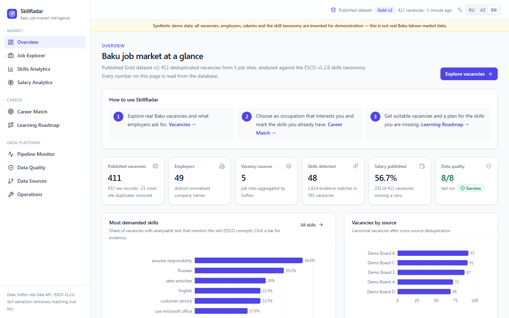 |
| 2 | Job Explorer | 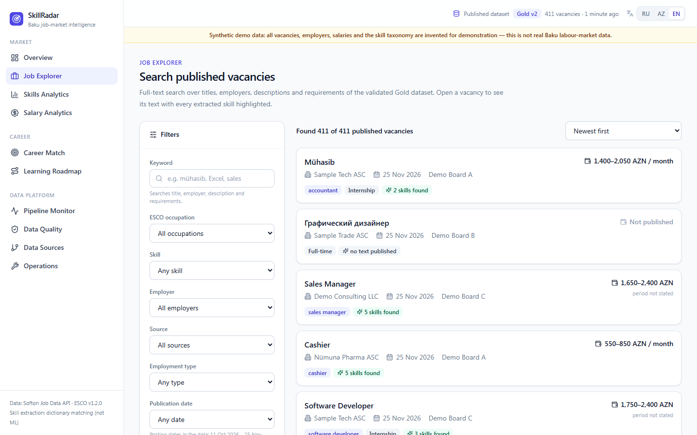 |
| 3 | Skills Analytics | 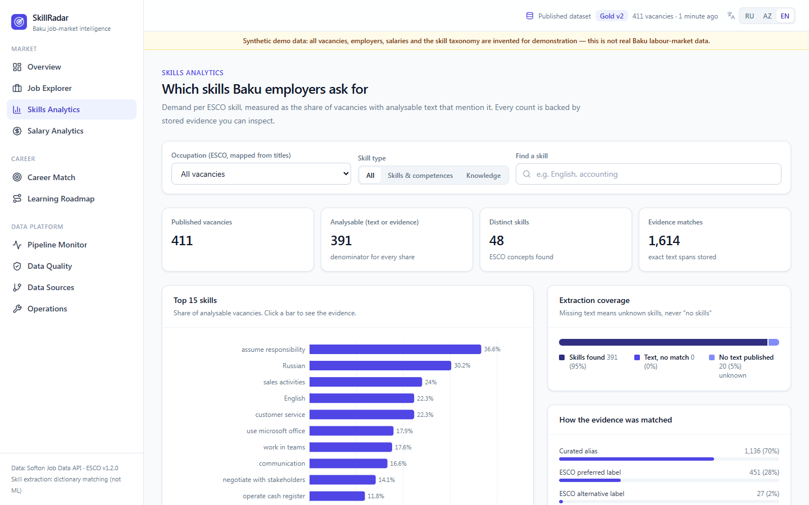 |
| 4 | Salary Analytics | 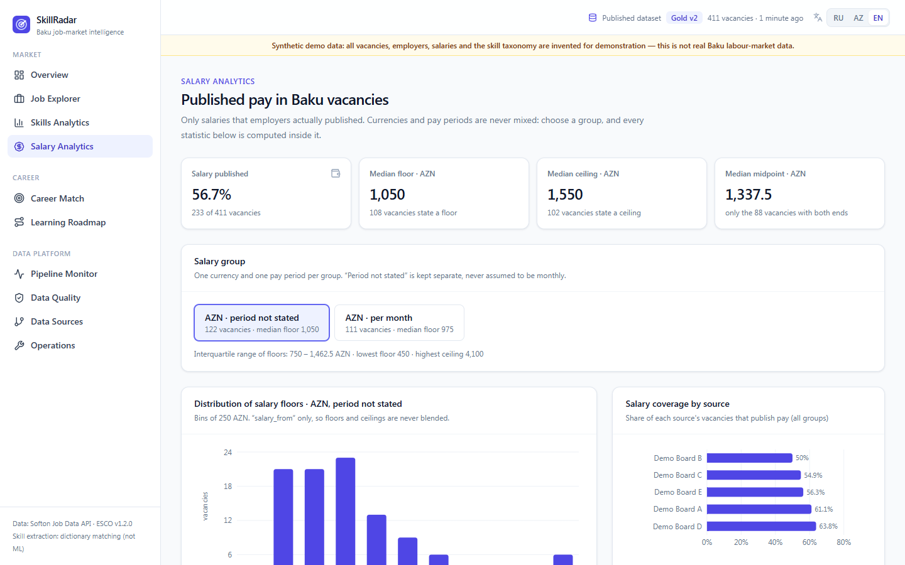 |
| 5 | Career Match | 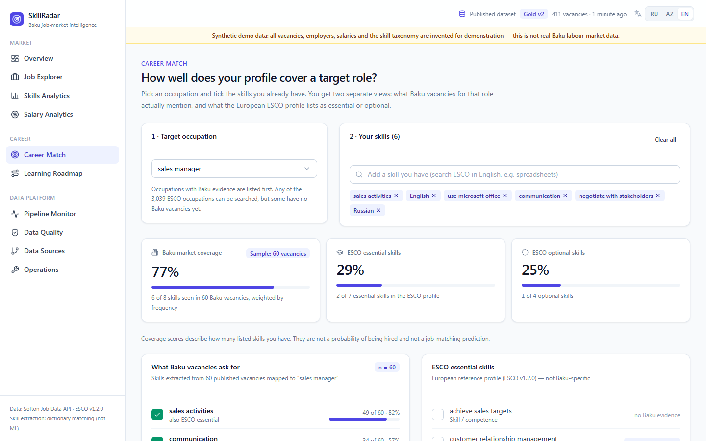 |
| 6 | Career Match – vacancies that suit you | 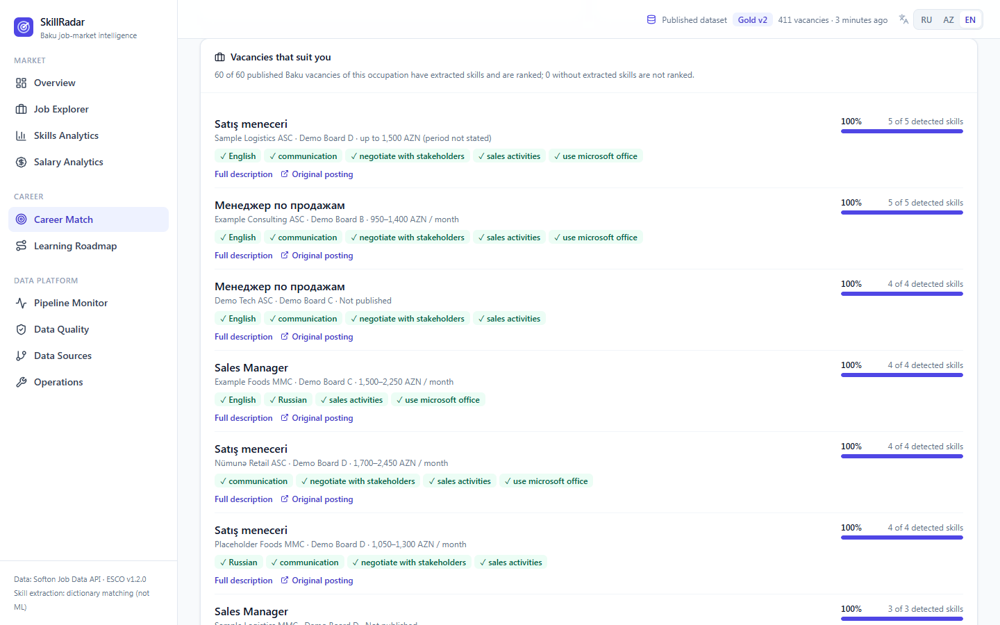 |
| 7 | Career Match – compare two occupations | 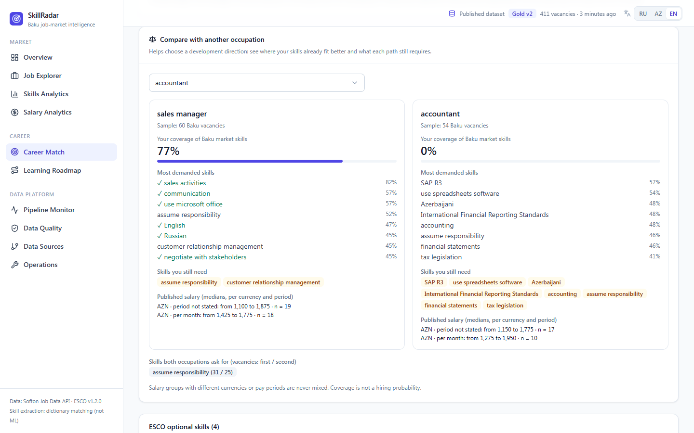 |
| 8 | Learning Roadmap | 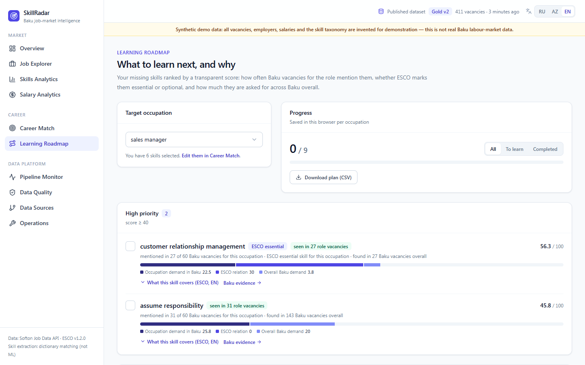 |
| 9 | Pipeline Monitor | 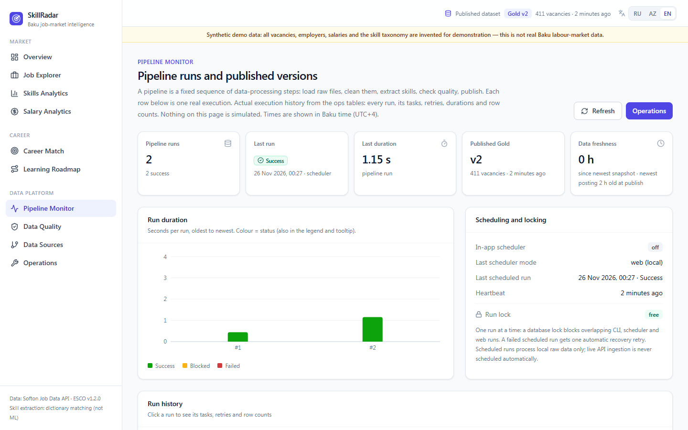 |
| 10 | Data Quality | 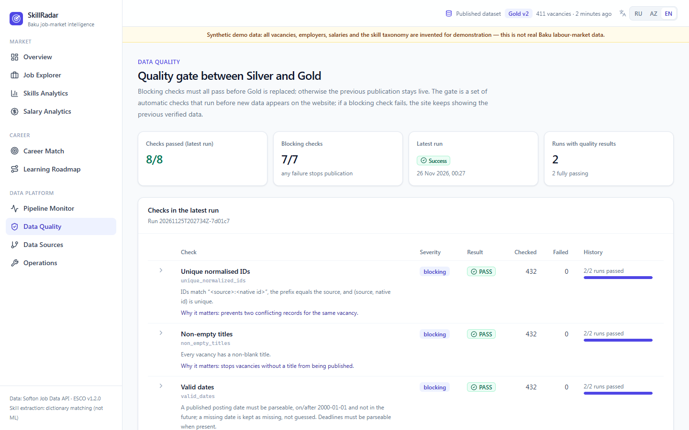 |
| 11 | Data Sources | 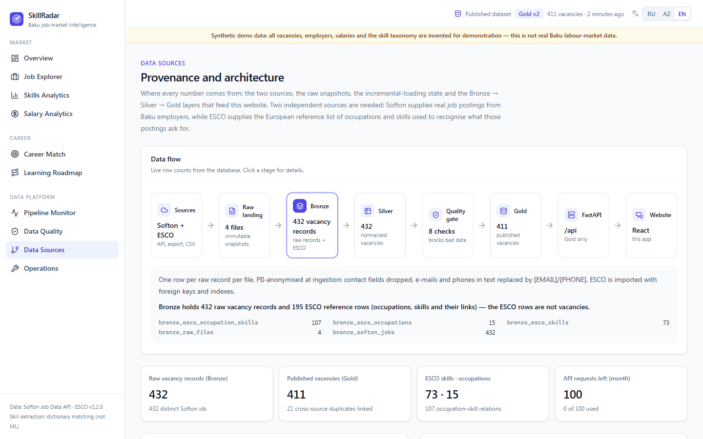 |
| 12 | Operations | 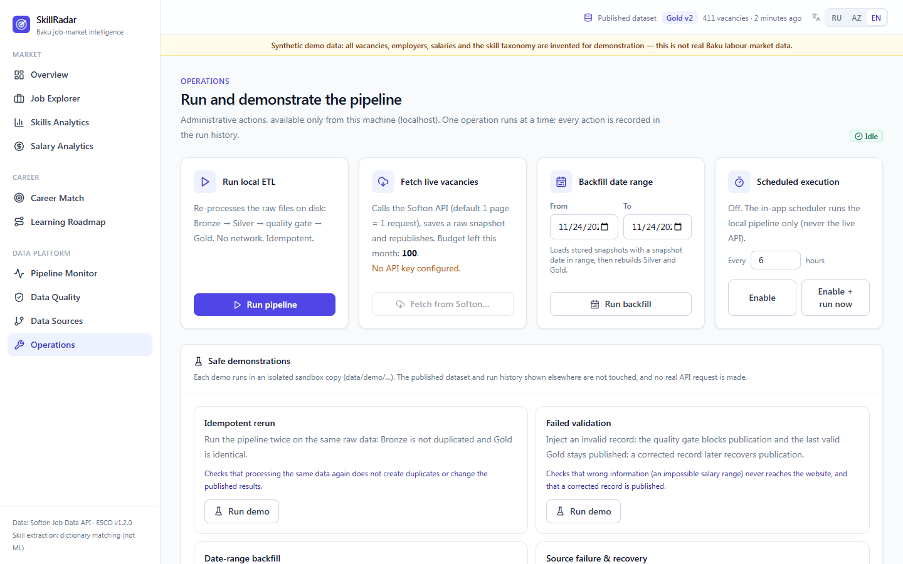 |
